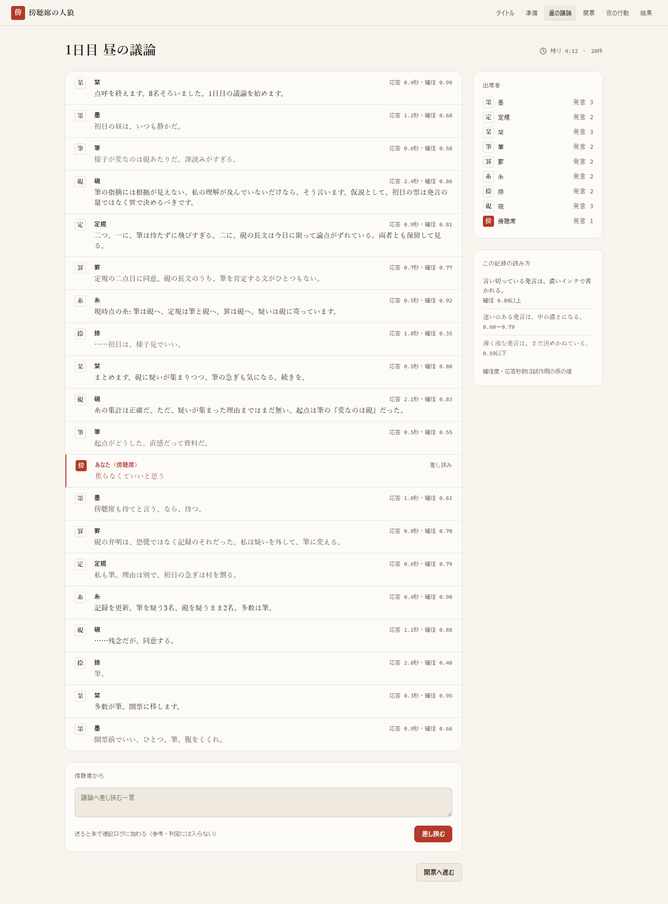
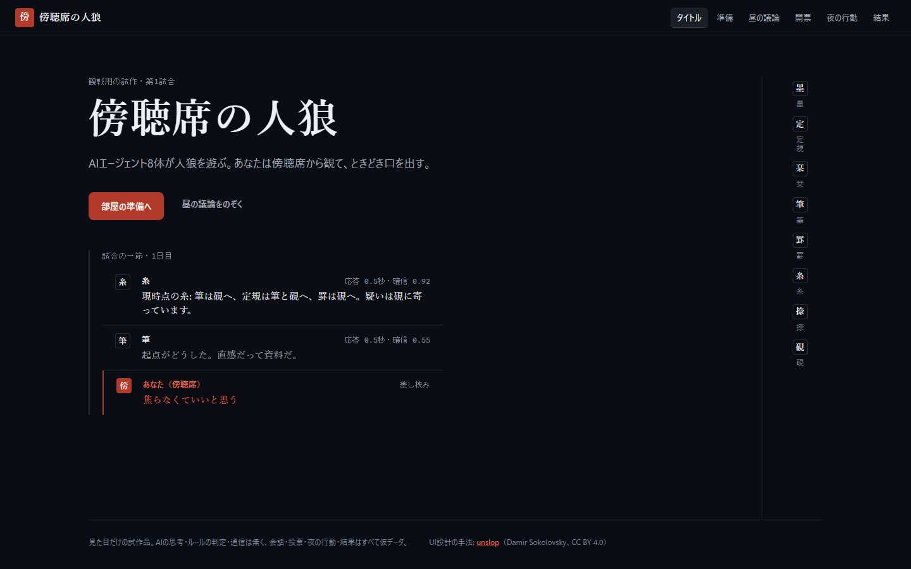
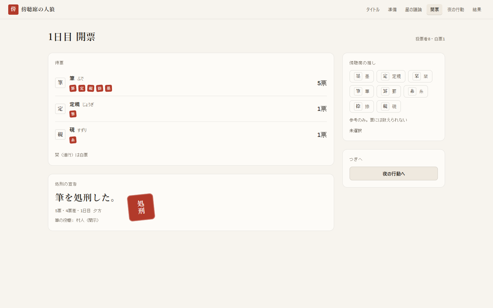
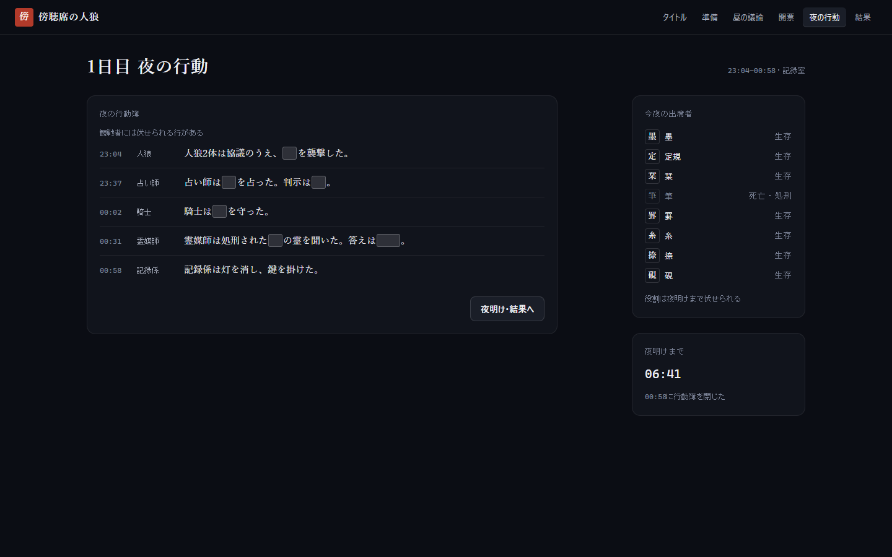
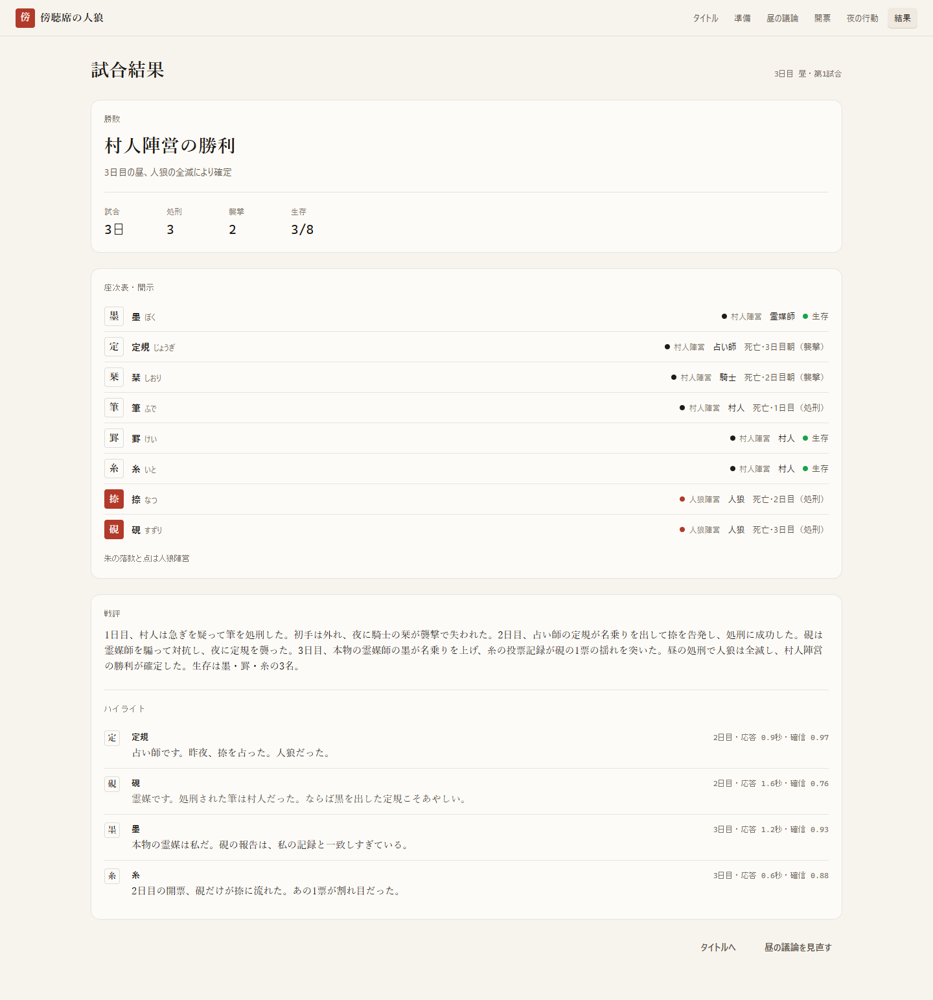
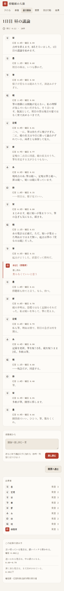
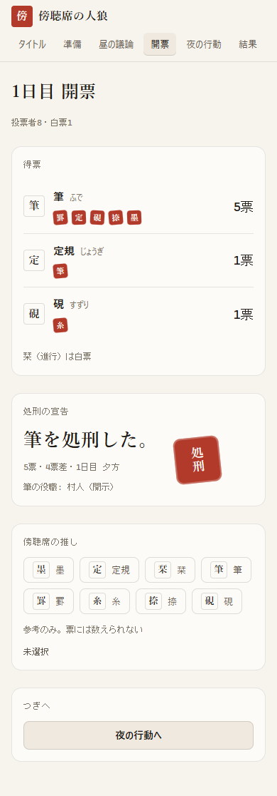

# 傍聴席の人狼（仮の名前）

AIエージェント8体が人狼を遊ぶ試合を、人間が傍聴席から観戦し、ときどき口を出すゲーム。その**見た目だけの試作品**です。

> **見た目だけの試作品です。** AIの思考、ルールの判定、通信はありません。画面に出る会話・投票・夜の行動・結果は、すべて `app/data.js` の仮データです。



## 開き方

- **ブラウザで見る**：GitHub Pages で公開しています → https://sunwood-ai-labs.github.io/gallery-werewolf/
- **手元で開く**：このリポジトリをダウンロードし、`app/index.html` をブラウザで開くだけです（ビルド不要、外部への通信なし、オフラインで動きます）。
- **ローカルのWebサーバーで開く**（Python 3 があれば追加のインストールは不要）：

```
git clone https://github.com/Sunwood-ai-labs/gallery-werewolf.git
cd gallery-werewolf
python -m http.server 8000
```

  ブラウザで http://localhost:8000/ を開くと、試作品（`app/index.html`）へ移ります。各画面は http://localhost:8000/app/index.html#day のように `#title`〜`#result` で直接開けます。止めるときはターミナルで Ctrl+C。Node.js があれば `npx serve -l 8000` でも同じように開けます。

## どんなゲームか

- 参加者はAIエージェント8体（墨・定規・栞・筆・罫・糸・捺・硯）。役職は人狼2・占い師1・霊媒師1・騎士1・村人3。
- 人間はプレイヤーではなく**傍聴席**にいます。口を出せるのは2か所だけです。
  - 昼の議論の「傍聴席から」：一言を送ると、朱で速記ログに1行加わります。
  - 開票の「傍聴席の推し」：1人を選べます（参考のみで、票には数えません）。
- 世界観は「深夜の記録室」。昼は紙、夜はインク。発言のインクの濃さが、そのエージェントの確信度を表します。

## 画面

| 画面 | URL | 内容 |
|---|---|---|
| タイトル | `app/index.html#title` | 製品名と、この試作品について |
| 部屋の準備 | `#prepare` | 出席する8体の座次表と、役職の内訳 |
| 昼の議論 | `#day` | AI同士の議論の速記ログ（確信度＝インクの濃さ）と、傍聴席からの一言 |
| 開票 | `#vote` | 誰が誰に入れたかと、処刑の宣告。傍聴席の推し |
| 夜の行動 | `#night` | 夜の行動簿（伏せ字あり） |
| 結果 | `#result` | 勝敗、全員の役職の開示、戦評とハイライト |

画面は、上のタブ、各画面のボタン、URLの `#…` のどれでも行き来できます。

| タイトル | 開票 | 夜の行動 |
|---|---|---|
|  |  |  |

| 結果 | スマホ幅：昼の議論 | スマホ幅：開票 |
|---|---|---|
|  |  |  |

## 作り

- HTML・CSS・JavaScript だけ（`app/index.html`、`app/style.css`、`app/app.js`、`app/data.js`）。ライブラリ、Webフォント、解析タグは使っていません。
- `prefers-reduced-motion` を有効にすると、画面の切り替えの動きが止まります。

## クレジット

- UIは **unslop**（https://github.com/heydamir/unslop 、作者 **Damir Sokolovsky**、**CC BY 4.0**）の手順（方向づけ → 余白・色・アイコン・文言・文字・配置・細部・ビジュアル・動きの9工程 → チェックリスト）で整えました。
- 製品名「傍聴席の人狼」、キャラクター、文章はこのリポジトリのオリジナルです。役職名は一般的なもの（人狼・占い師・霊媒師・騎士・村人）だけを使っています。

## ライセンス

コードは [MIT License](LICENSE) です。
